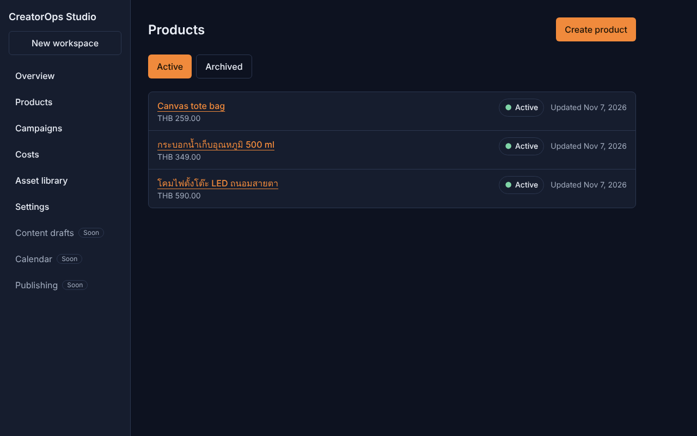
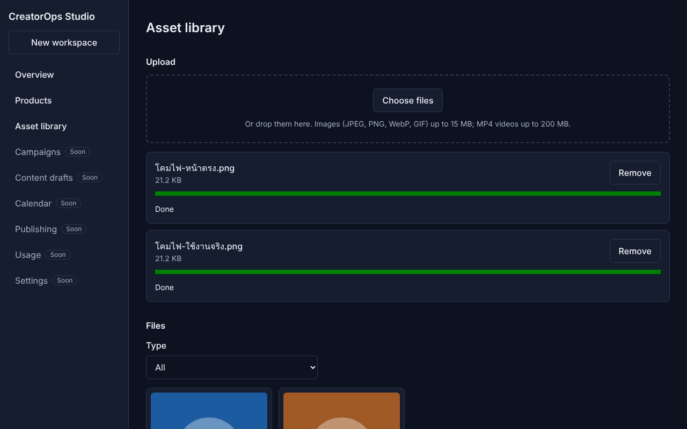
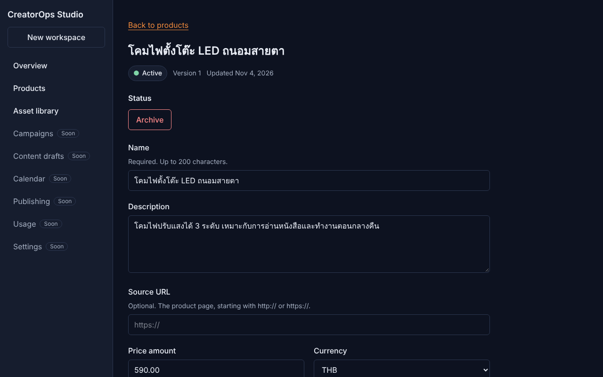
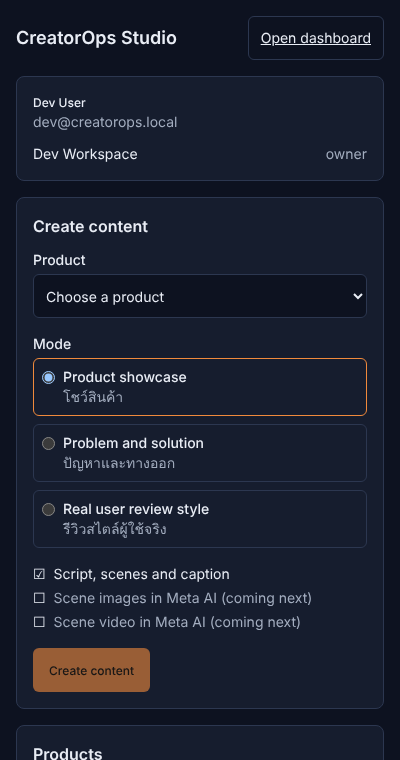
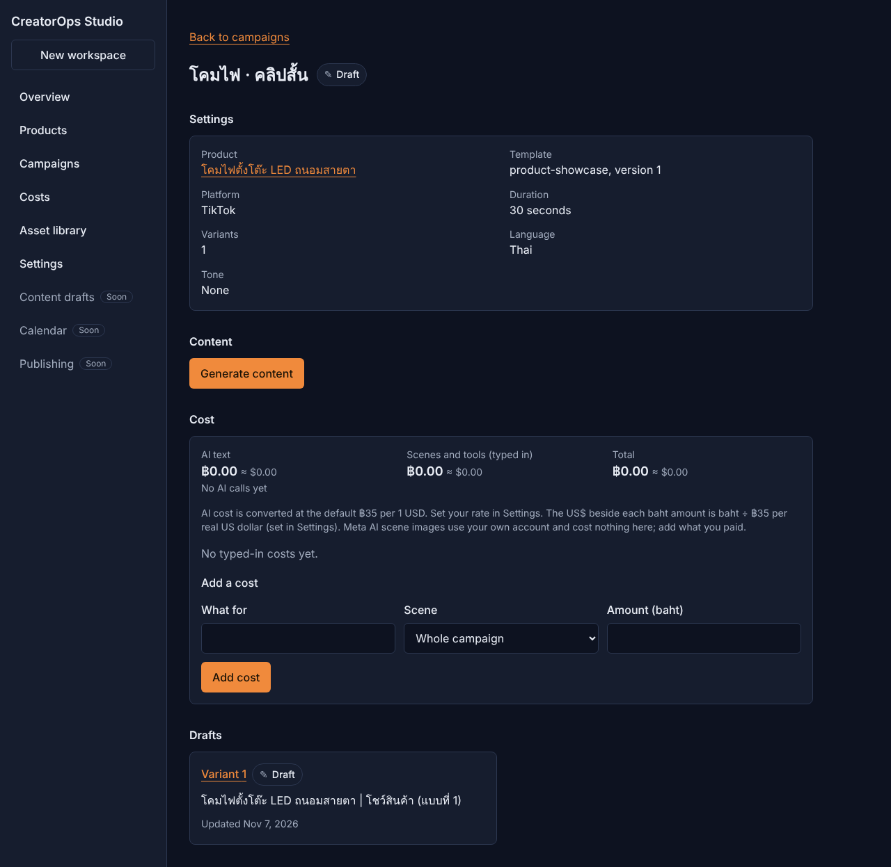
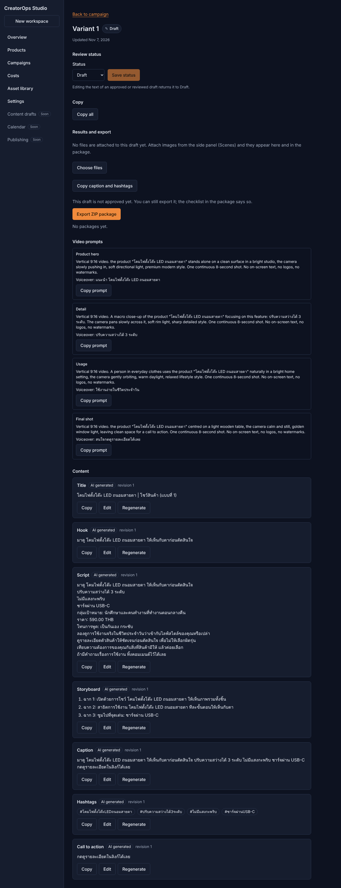
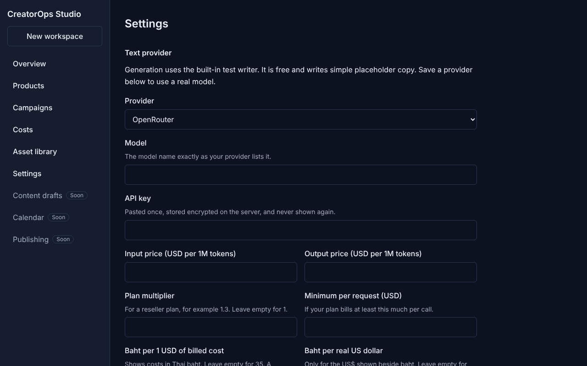
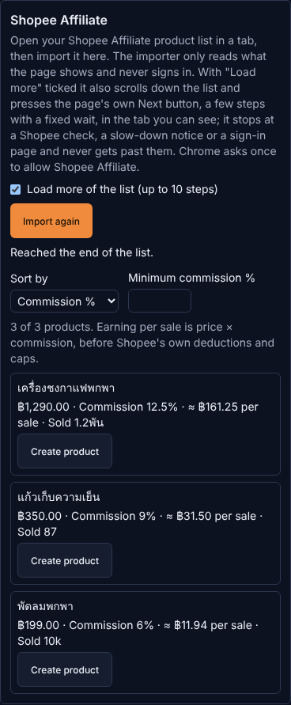

# CreatorOps Studio

An extension-first content operations tool for Thai solo sellers, affiliate creators, small e-commerce teams, and agencies. It turns a product listing and a few product photos into reviewed, platform-ready short-form content.

> **Core promise:** one product brief → a week of reviewed, platform-ready content.

**Working name.** The product may be renamed later. The product is inspired by the visible workflow patterns of an existing tool, but it does not copy its branding, hidden implementation, or unverified capabilities.

## Status

Built and verified against fake pages and a mock provider (the owner tests the real Meta AI, Flow and Shopee tabs): monorepo and CI, API with mock auth, web dashboard, Chrome MV3 side panel, workspaces, products, media uploads, campaigns and drafts with a job worker, real text through an OpenAI-compatible provider, the Meta AI and Flow helpers, the Shopee importer, video prompts and ZIP export. Current progress is in `docs/IMPLEMENTATION_STATUS.md`; a short handoff is in `docs/WORKING_NOTES.md`. See "Getting started" below to run it locally.

### Screenshots (captured from the running app)

Regenerate with `node scripts/capture-screenshots.mjs` (needs `DATABASE_URL`, `REDIS_URL`, built packages and the extension e2e build; see the script header). The side panel is loaded as a tab because automation cannot open Chrome's real side panel.

| Dashboard products | Asset library (uploaded) |
|---|---|
|  |  |

| Product detail | Extension side panel |
|---|---|
|  |  |

| Campaign page | Draft with video prompts and export |
|---|---|
|  |  |

| Settings (text provider) | Shopee importer in the side panel |
|---|---|
|  |  |

The Shopee shot uses a fake Shopee page; the draft uses the free mock text writer. More in `docs/screenshots/`: `web-overview.png`, `web-new-workspace.png`, `extension-create.png`.

## Try it locally (one command)

Needs Node 22+ and pnpm 10 (run `pnpm install` once). Then:

```
pnpm demo
```

It starts PostgreSQL and Redis without Docker, builds the dashboard and the extension, creates a `creatorops_demo` database (kept between runs), and runs the API, the worker and the dashboard at <http://localhost:5173>. Sign-in is a local mock and text generation uses the mock provider (Thai copy from templates), so no account, key or paid service is needed. Press Ctrl+C to stop. To use the side panel, load `apps/extension/dist` as an unpacked extension in Chrome (`chrome://extensions`, Developer mode). `pnpm dev:db:stop` and `pnpm dev:redis:stop` stop the databases.

## How it works

- **Chrome side panel** (Manifest V3) is the quick-entry surface. It is a thin client.
- **Web dashboard** is the full workspace.
- **Backend API and worker** own durable state, provider calls, secrets, storage, retries, and audit.
- **Providers are replaceable.** Everything runs on mock providers until a real one passes the approval gate.

## First release scope

Product workspace → Thai-first copy and script generation → asset upload and library → job status → review and export. Publishing connectors are feature-gated and approval-dependent; manual export comes first.

## What this product will not do

No fake views, likes, comments, or follows. No account warming. No scraping or automating social platforms. The only exceptions are three owner-approved, user-initiated helpers that act in the owner's own signed-in tab, never sign in and never get past a check: Meta AI (D-071), Google Flow (D-080) and the Shopee Affiliate importer (D-082, D-083). No CAPTCHA, fingerprint, or proxy evasion. No device-farm control. Publishing only through official APIs after access is confirmed. See `docs/05_SECURITY_AND_COMPLIANCE.md` §6.

## Documentation

Start with `docs/README.md`, which lists every document and which one wins when two disagree.

To set up and use the product, read `docs/USER_GUIDE.md`; for whether it is ready for a real test, `docs/READY.md`.

| Document | Purpose |
|---|---|
| `CLAUDE.md` | Instructions and constraints for Claude Code |
| `docs/01_PRODUCT_REQUIREMENTS.md` | Requirements and MVP boundary |
| `docs/02_SYSTEM_ARCHITECTURE.md` | Architecture and stack |
| `docs/03_UX_AND_EXTENSION_SPEC.md` | Screens and extension behaviour |
| `docs/04_DATA_MODEL_AND_API.md` | Entities and API contract |
| `docs/05_SECURITY_AND_COMPLIANCE.md` | Security, privacy, platform rules |
| `docs/06_IMPLEMENTATION_ROADMAP.md` | Phases 0–8 |
| `docs/07_ACCEPTANCE_TESTS.md` | MVP acceptance checklist |
| `docs/08_PHASE_PLAN.md` | Phase 0–2 slices, working method, definition of done (Phase 3 plan is in `DECISIONS.md` D-045 to D-061) |
| `docs/WORKING_NOTES.md` | Short handoff: where we are, commands, gotchas, next steps |
| `docs/ARCHITECTURE.md` | Concrete layout, conventions, module pattern |
| `docs/DECISIONS.md` | Decision log and open questions |
| `docs/IMPLEMENTATION_STATUS.md` | Live progress |
| `docs/00_REFERENCE_PRODUCT_ANALYSIS.md` | Background research |
| `docs/REFERENCE_OBSERVATIONS.md` | Unverified notes on the reference screenshots |

## Planned repository layout

```text
apps/extension     Chrome MV3 side panel
apps/web           dashboard
apps/api           HTTP API and worker entry point
packages/contracts shared Zod schemas and API types
packages/provider-core  provider interfaces, adapters, mocks
packages/ui        shared UI primitives
packages/config    shared lint, tsconfig, env helpers
infra/             docker compose and SQL migrations
```

## Project skills

`.claude/skills/app-dev-methodology` is available to Claude Code in this project. It is a general planning guide; project rules in `CLAUDE.md` and `docs/` take precedence.

## Getting started

Everything runs locally on mock providers; no paid credentials are needed. PostgreSQL 16 and Redis 7 start without Docker.

```
pnpm install --frozen-lockfile
pnpm dev:db && export DATABASE_URL="$(bash scripts/pg-local.sh url)"
pnpm dev:redis && export REDIS_URL="$(bash scripts/redis-local.sh url)"
pnpm db:migrate && pnpm db:seed
```

Set the API environment (see `.env.example`): `AUTH_MODE=mock`, `API_BASE_URL`, `WEB_ORIGIN`, `EXTENSION_ORIGIN`, and a random `SESSION_SECRET` (keep it out of git). Then:

```
pnpm build
node apps/api/dist/server.js     # API
pnpm dev:worker                  # background worker (needs REDIS_URL)
pnpm --filter @creatorops/web dev   # dashboard (Vite)
cd apps/extension && VITE_AUTH_MODE=mock VITE_API_BASE_URL=http://localhost:3000 pnpm exec vite build
```

Load `apps/extension/dist` as an unpacked extension in `chrome://extensions`. A plain `pnpm build` does not set `VITE_AUTH_MODE`, so the side panel would say "Sign-in is not configured yet". Services stop between sessions; restart them and re-export `DATABASE_URL` and `REDIS_URL` before running tests.

## Development commands

Requires Node 22 or newer and pnpm 10.28.0 (set in `packageManager`; enable with `corepack enable`).

```
pnpm install               # install the workspace (uses pnpm-lock.yaml)
pnpm lint                  # ESLint in every workspace package, including dependency rules
pnpm typecheck             # tsc --noEmit in every package
pnpm test                  # builds, then Vitest in every package
pnpm build                 # tsc emit to dist/ in every package
pnpm format                # Prettier write
pnpm format:check          # Prettier check
pnpm dev:db                # start PostgreSQL 16 locally without Docker (scripts/pg-local.sh)
pnpm dev:db:compose        # or start it with Docker Compose
pnpm dev:db:stop           # stop the local PostgreSQL
pnpm dev:redis             # start Redis 7 locally without Docker (scripts/redis-local.sh)
pnpm dev:redis:stop        # stop the local Redis
pnpm dev:worker            # build, then run the background job worker
pnpm db:migrate            # apply migrations (never rely on implicit schema creation)
pnpm db:seed               # seed the dev database
pnpm e2e                   # end-to-end tests (dashboard and extension) on a fresh creatorops_e2e database
```

Copy `.env.example` to `.env` for local values. Real `.env` files are git-ignored.

Database tests read `DATABASE_URL`. After `pnpm dev:db`, run `export DATABASE_URL="$(bash scripts/pg-local.sh url)"`. Without it they fail with instructions; set `SKIP_DB_TESTS=1` to skip them on purpose. The Redis queue tests read `REDIS_URL` the same way (`SKIP_REDIS_TESTS=1` to skip). `pnpm e2e` needs `export PLAYWRIGHT_BROWSERS_PATH=/opt/pw-browsers` where Chromium is preinstalled.
